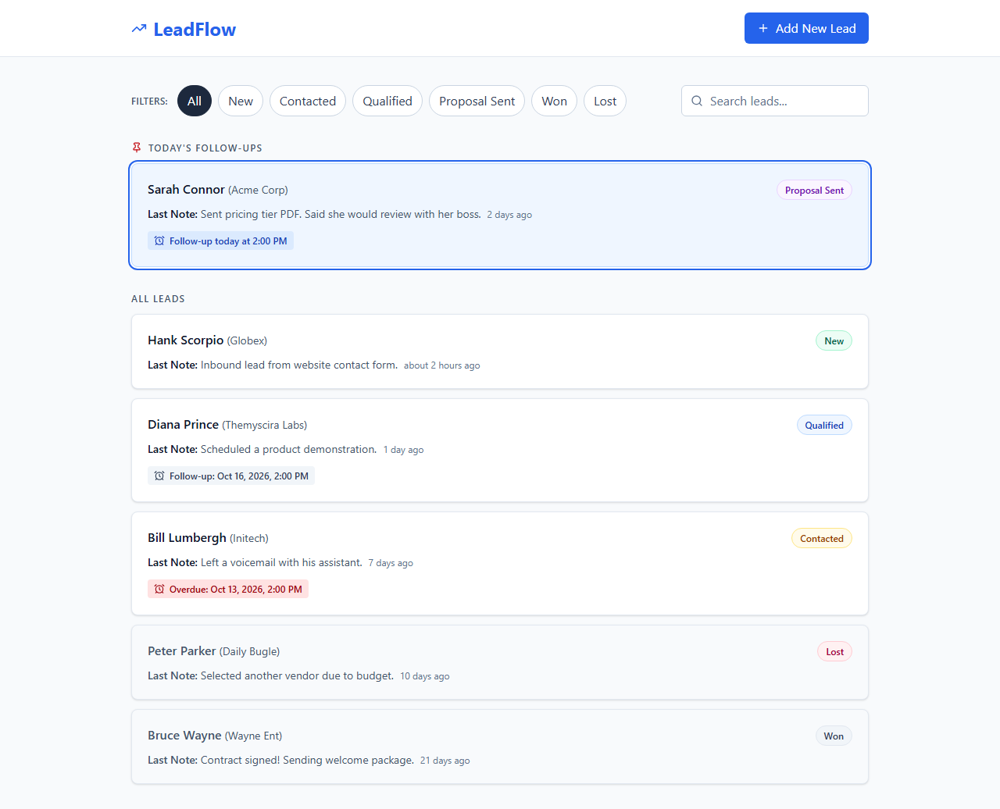

# LeadFlow

I built LeadFlow as a solo Fullstack Intern assessment for tracking leads, discussions and follow-ups. I use Next.js App Router, strict TypeScript, Tailwind v4, Express 5, Mongoose 8 and MongoDB 7. I implemented status filters, search, pinned daily follow-ups, overdue reminders, timeline dialogs, notes, persistent status changes, follow-up clearing, lead creation and a six-lead seed.



I provide a [3:24 annotated feature walkthrough](https://github.com/tusharg007/leadflow-pravarai/releases/tag/walkthrough-2026-10-16) and a [chapter-by-chapter guide](docs/DEMO_WALKTHROUGH.md). The recording shows real browser workflows with explanations embedded in the video.

## Docker quick start

I use Docker Desktop with Linux containers and Compose v2. From a fresh clone's root, I run:

```powershell
# Windows PowerShell
Copy-Item .env.example .env
docker compose -p leadflow up --build -d
docker compose -p leadflow ps
# I wait for all three services to be healthy before seeding.
docker compose -p leadflow exec -T backend npm run seed:prod
Start-Process http://localhost:3000
```

```sh
# macOS / Linux
cp .env.example .env
docker compose -p leadflow up --build -d
docker compose -p leadflow ps
# Wait for all three services to be healthy.
docker compose -p leadflow exec -T backend npm run seed:prod
# Open http://localhost:3000 in a browser.
```

I check the API in PowerShell with `Invoke-RestMethod http://localhost:4000/api/health` and `Invoke-RestMethod http://localhost:4000/api/leads`. I stop only my project with `docker compose -p leadflow down`, preserving `leadflow_mongo_data`.

My MongoDB service publishes no host port, and generated names keep an existing `leadflow-mongo` separate from `leadflow-mongo-1`. If 3000/4000 is busy, I change root `.env` values `FRONTEND_PORT`/`PORT`, update `CORS_ORIGINS` and `NEXT_PUBLIC_API_URL` to the new browser URLs, then rebuild. I never use the internal Docker hostname `backend` as the browser API URL.

## Manual start

I use Node.js 22.13 or newer within the Node 22 major, npm and MongoDB 7. My checks used Node 22.21.0. I start from the repository root.

If MongoDB is installed and `mongod` is on PATH, I can start an isolated local instance in a separate terminal:

```powershell
# Windows PowerShell
New-Item -ItemType Directory -Force .cache/mongo-data
mongod --dbpath .cache/mongo-data --bind_ip 127.0.0.1 --port 27017
```

```sh
# macOS / Linux
mkdir -p .cache/mongo-data
mongod --dbpath .cache/mongo-data --bind_ip 127.0.0.1 --port 27017
```

I then install and start the backend in another terminal:

```powershell
# Windows PowerShell
Set-Location backend
Copy-Item .env.example .env
npm ci
npm run seed
npm run dev
```

```sh
# macOS / Linux
cd backend
cp .env.example .env
npm ci
npm run seed
npm run dev
```

I start the frontend from the repository root in another terminal:

```powershell
# Windows PowerShell
Set-Location frontend
Copy-Item .env.example .env.local
npm ci
npm run dev
```

```sh
# macOS / Linux
cd frontend
cp .env.example .env.local
npm ci
npm run dev
```

I open `http://localhost:3000`. I edit `backend/.env` for database/origin changes and `frontend/.env.local` for the API URL. I run scripts from each app's directory to load its environment; root `.env` supplies Compose values.

I check the API with `curl.exe http://localhost:4000/api/health` in PowerShell or `curl http://localhost:4000/api/health` on macOS/Linux. I expect `{ "status": "ok" }`.

For the compiled backend, I use these cross-platform commands:

```powershell
cd backend
npm run build
npm run seed:prod
npm start
```

I stop the server with Ctrl+C. My server handles SIGINT and SIGTERM by closing HTTP connections and disconnecting MongoDB, with a ten-second shutdown limit.

For a manual production frontend I run `npm run build` and `npm start` from `frontend/`, setting its public API URL before building. I stop each manual server with Ctrl+C.

## Environment

| Variable            | Default / example                  | Purpose                                                                    |
| ------------------- | ---------------------------------- | -------------------------------------------------------------------------- |
| PORT                | 4000                               | Backend listen port                                                        |
| MONGODB_URI         | mongodb://127.0.0.1:27017/leadflow | Required database URI                                                      |
| CORS_ORIGINS        | http://localhost:3000              | Comma-separated HTTP(S) browser origins, without paths or trailing slash   |
| NODE_ENV            | development                        | development, test, or production                                           |
| LOG_LEVEL           | info                               | fatal, error, warn, info, debug, trace, or silent                          |
| NEXT_PUBLIC_API_URL | http://localhost:4000/api          | Browser API URL embedded at build time; passed as a Compose build argument |
| FRONTEND_PORT       | 3000                               | Compose frontend host port; internal port stays 3000                       |

In Compose, `PORT` is the backend host port; internal backend port remains 4000. Compose fixes `MONGODB_URI` to its private service and `NODE_ENV` to production. My optional browser runner sets `FRONTEND_URL`/`E2E_API_URL` for alternate free ports; they are unused by the product and can also configure a direct Playwright run.

I never commit real `.env` files. My logs exclude request bodies, headers, query strings, and raw driver error messages to avoid exposing credentials.

## Seed

I seed six fictional leads covering all statuses, with three discussions each. I include Sarah Connor, Hank Scorpio, Bill Lumbergh, Bruce Wayne, Diana Prince, and Peter Parker. Relative to the seed instant, Sarah's follow-up is 30 minutes ahead, Bill's is 26 hours earlier, and Diana's is 50 hours ahead.

I calculate seed dates with elapsed millisecond offsets and store UTC dates, independently of the process timezone. Sarah's follow-up can fall on the next local day when I seed within 30 minutes of midnight. Repeated seed runs skip fixtures with their deterministic IDs and preserve user changes. I use `npm run seed -- --reset` (or `npm run seed:prod -- --reset`) only when I intend to delete **all leads and discussions in the configured database** and refresh the fixtures relative to the current instant. I do not run seed processes concurrently.

Inside Docker, I use `docker compose -p leadflow exec -T backend npm run seed:prod`; I append `-- --reset` only when I intend to rebuild that project's demo data.

## API and architecture

I define the HTTP contract in [docs/API.md](docs/API.md). My backend separates routes, controllers, services, and Mongoose models. I keep the reference assignment and screenshots local and excluded from Git.

| Method | Path                          | Result                                    |
| ------ | ----------------------------- | ----------------------------------------- |
| GET    | /api/health                   | Liveness                                  |
| GET    | /api/leads?status=new&q=sarah | Filtered list, last discussion descending |
| POST   | /api/leads                    | New lead plus system discussion           |
| GET    | /api/leads/:id                | Lead plus newest-first history            |
| PATCH  | /api/leads/:id                | Status and/or follow-up update            |
| POST   | /api/leads/:id/discussions    | Note and updated lead summary             |

I can create a lead on macOS/Linux with:

```sh
curl -X POST http://localhost:4000/api/leads \
  -H 'Content-Type: application/json' \
  -d '{"name":"Sarah Connor","company":"Acme Corp","phone":"555-0199"}'
```

In PowerShell, I use JSON serialization to avoid native argument quoting differences:

```powershell
$leadBody = @{ name = 'Sarah Connor'; company = 'Acme Corp'; phone = '555-0199' } | ConvertTo-Json
Invoke-RestMethod -Method Post -Uri http://localhost:4000/api/leads -ContentType 'application/json' -Body $leadBody
```

I organize the repository as follows:

```text
frontend/src/app/          route, layout, Inter, providers, tokens
frontend/src/components/   accessible TypeScript primitives
frontend/src/features/     API, hooks, forms, list/dialog UI, date utilities
frontend/tests/            Vitest + RTL + MSW integration
frontend/e2e/              one Playwright persistence smoke test
frontend/scripts/          isolated browser runner and screenshots
backend/src/config/       environment, database, logger
backend/src/models/       indexed Mongoose schemas
backend/src/schemas/      strict request validation
backend/src/routes/       endpoint wiring
backend/src/controllers/  HTTP translation
backend/src/services/     persistence and compensation rules
backend/src/middleware/   validation, not-found, error envelope
backend/src/utils/        errors, normalization, serialization, regex escaping
backend/src/scripts/      seed CLI, fixtures, persistence
backend/tests/            API, HTTP, persistence, seed tests
docs/API.md               shared contract
docs/codex/               implementation brief
```

## Assumptions

- I store and transport UTC timestamps and calculate follow-up buckets in the browser's local timezone.
- I show today's follow-ups only in the pinned section, sorted by time; the rest retain API order. Earlier times today remain pinned and show a red overdue chip. A follow-up is overdue strictly before the current instant; exactly now is not overdue.
- I preserve a lead's follow-up when a note omits `followUpAt`; explicit `null` clears it.
- I keep the list unpaginated because I expect a small assessment dataset.
- I use compensated writes instead of transactions so the backend works with standalone MongoDB.
- I omit authentication as directed by the project brief.
- I treat all mutation bodies and list query parameters as strict objects, rejecting unknown keys and repeated query values.
- I accept only name, company, and phone when creating a lead; its initial status is always New.
- I require both local date/time when follow-up is enabled, reject past dates and nonexistent DST-gap times, and use JavaScript's earlier occurrence for ambiguous repeated times.
- I fall back to All for invalid URL status and cap search at 100 characters. I replace the history entry while typing search and use history entries for filters/dialogs.
- I use locally bundled Inter through next/font/local so builds do not need Google Fonts.

## Known trade-offs

I cannot guarantee cross-collection atomicity across process crashes or cleanup failures without MongoDB transactions. I compensate ordinary write failures and test those paths. Overlapping discussion writes use the last completed lead update for the summary; I do not promise conflict resolution across concurrent requests. My seed does not repair a pre-existing fixture left incomplete by a process crash; I use reset to rebuild demo data when needed.

I use literal substring search, which can scan the collection despite the name index. I accept this for a small unpaginated dataset. `/api/health` is liveness only, and API failures never expose internal diagnostics. I use TanStack Query cache updates and optimistic status rollback, URL state `?status=&q=&lead=`, 300ms search debounce and a one-minute clock refresh; dialogs keep every flow on `/`.

I retain ESLint 9.39.5 because Next's React plugin does not support ESLint 10. npm marks ESLint 9 unsupported and reports five high development-only advisories through Next's lint glob chain (`braces` stack-exhaustion); no patched braces release is available. I record this separately from production dependencies.

## Testing

I run the same gate from `backend/` and `frontend/`:

```powershell
npm run lint && npm run typecheck && npm test && npm run build
npm run format:check
```

In PowerShell 5.1 I run each command separately; PowerShell 7 and macOS/Linux support the combined command. My 68 backend and 49 frontend tests cover contracts, persistence, privacy, compensation, timezone-independent seeds, overdue/DST boundaries, request headers, cache movement/rollback, keyboard focus, slow/error states and double submits. Tests use isolated MongoDB 7.0.24 and MSW; the initial run may download a large binary.

With both app dependencies installed, I run optional browser checks from `frontend/`:

```powershell
npx playwright install chromium
npm run test:e2e
npm run screenshots
```

My runner seeds an isolated database, builds both apps, starts owned servers on free ports and stops them afterwards. The smoke test verifies follow-up movement and status persistence after reload. Screenshot checks cover 360/768/1280 layouts, focus trapping, maximum-length text, overdue contrast and reachable dialog controls at 360×640 and 320×568. I record results in [the report](docs/codex/06_AUTONOMOUS_RUN_REPORT.md) and [timestamped log](docs/codex/AUTONOMOUS_RUN_LOG.md).

## Screenshots and demo

I keep [mobile](docs/screenshots/list-360.png), [tablet](docs/screenshots/list-768.png), [add-lead](docs/screenshots/add-lead-dialog.png), [timeline](docs/screenshots/timeline-dialog.png), [long mobile timeline](docs/screenshots/timeline-long-mobile.png), and [overdue](docs/screenshots/overdue-lead.png) screenshots in `docs/screenshots/`. My submission video remains a placeholder: **[add demo video link here]**.

## AI usage

I used OpenAI Codex under my phase prompts and project instructions to generate the contract, backend, frontend, tests, Dockerfiles and docs. Codex reviewed failures and exercised automated browser flows, correcting logging/CORS, abort handling, strict optional types, font paths, responsive truncation and test tooling. I have not yet completed my own personal review or submission video. I distinguish those human tasks from the recorded automated verification and keep prompt references in [docs/AI_USAGE.md](docs/AI_USAGE.md).
