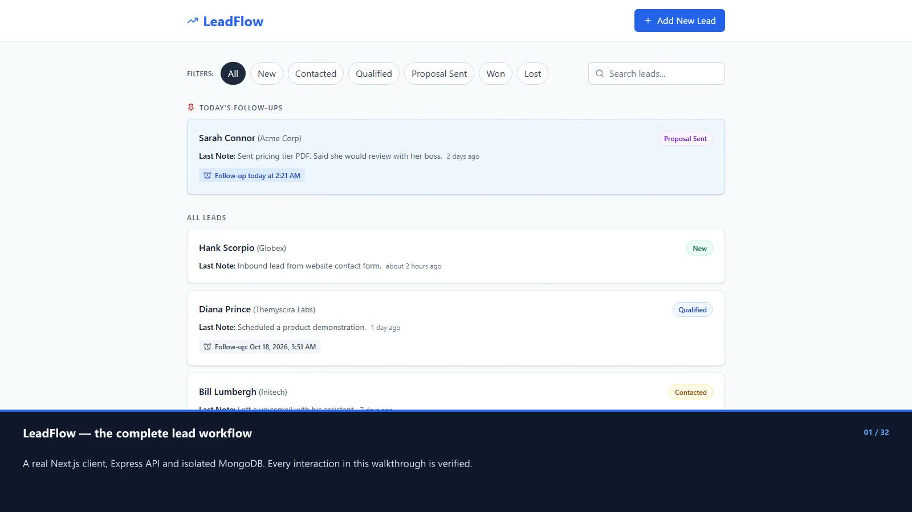

# LeadFlow annotated walkthrough

I also provide a [focused Docker quick-check video covering the six requested review checks](DOCKER_QUICK_CHECK.md).

I recorded this walkthrough on October 16, 2026, from application commit `efd43ac`. I used automated Chromium interactions against the real compiled Next.js client, Express API and an isolated MongoDB 7 instance. I did not change product code for the recording or use production/user data.

I provide the [GitHub video release](https://github.com/tusharg007/leadflow-pravarai/releases/tag/walkthrough-2026-10-16) and a [repository copy of the MP4](demo/leadflow-walkthrough.mp4). The video is **3:24**, **1600×900**, **30 fps**, H.264, and silent. All explanations are burned into a separate annotation band below the app; I do not require a subtitle file. I trimmed setup and transitions while retaining actions at normal speed and short result-reading holds.

## Chapters

| Time | Feature                                         |
| ---- | ----------------------------------------------- |
| 0:00 | LeadFlow — the complete lead workflow           |
| 0:04 | Prioritize today; keep the rest in order        |
| 0:10 | All six status filters                          |
| 0:20 | Search case-insensitively                       |
| 0:23 | Combine filters and search                      |
| 0:28 | Literal search and a clear empty state          |
| 0:34 | Open the full discussion timeline               |
| 0:40 | Save a discussion without changing the reminder |
| 0:49 | Schedule a follow-up from a discussion          |
| 0:58 | The lead moves into Today immediately           |
| 1:02 | Earlier today is overdue — and still pinned     |
| 1:11 | Close a lead without showing a false alarm      |
| 1:18 | Status and history persist after reload         |
| 1:26 | Clear the reminder; keep the discussion history |
| 1:31 | Won leads are neutral too                       |
| 1:41 | Create a lead — required fields are guarded     |
| 1:47 | Add a complete contact                          |
| 1:58 | Date and time are required together             |
| 2:05 | Correct the form and save a future reminder     |
| 2:10 | Optional contact details stay optional          |
| 2:17 | Shareable URL state and a persistent dialog     |
| 2:23 | Keyboard-friendly dialogs                       |
| 2:28 | Loading states on a slower connection           |
| 2:33 | Retry recovers from a network interruption      |
| 2:40 | Browser timezone: America/Los_Angeles           |
| 2:44 | Browser timezone: Pacific/Auckland              |
| 2:48 | The API contract is verified too                |
| 2:54 | A responsive single-screen workflow             |
| 2:59 | Long names and notes do not hide the form       |
| 3:03 | The footer stays reachable on small screens     |
| 3:13 | A clean empty instance is ready to use          |
| 3:17 | Verified architecture and delivery              |

## What I verified

- I exercised all six status filters, combined filter/search state, mixed-case search and literal punctuation, no-results and empty-instance states.
- I checked newest-first discussion history, italic system entries, note-only follow-up preservation, immediate pinned movement, elapsed-time overdue styling, clear follow-up and reload persistence.
- I compared open, Lost and Won reminders using real mutations. Closed reminders are neutral; pinning still follows the local calendar day.
- I created both a complete contact and a name-only contact, checked required-name and date/time validation, corrected the form, and saved a future reminder.
- I checked URL deep links, keyboard focus trapping/return, real-response loading skeletons and recovery after a controlled browser-network interruption.
- I checked local-day membership in Los Angeles and Auckland using the same stored UTC timestamps. I checked mobile interactions at 360×640 and dialog bounds at both 360×640 and 320×568 with 120-character name/company and a 5,000-character note.
- I verified actual API success responses and the validation/not-found error envelope. The API result card displays captured response data.
- I ran lint, strict typecheck, tests, build and format checks in both apps before filming: **68 backend tests** and **49 frontend tests** passed. I observed **zero unexpected browser errors** in the completed rehearsal and final recording.

## Recording decisions

I found the configured GitHub origin was absent and created `tusharg007/leadflow-pravarai` as a private repository for publication. I keep the video, poster and verification record in my local repository and publish the MP4 as a GitHub release asset. Automatic approval review rejected a full source-history push, so this recording task publishes only a video index and the requested MP4.

I use search queries and discussion text as test inputs because LeadFlow has no AI prompting feature. I label intentional invalid-form, delayed-response and network-interruption scenarios in the video; they demonstrate expected validation/recovery behavior. I clear only the disposable demo database for the empty-instance chapter, and I discard it after the recording.

I corrected a relative-time display issue found during video review: a newly saved discussion could be newer than the list's cached clock and briefly read as future time. I clamp discussion ages to the cached present and added regression tests before recording the final take.

I used ports 3100/4100 because existing services occupied 3000/4000. I stopped every browser, server and temporary database process I started and left the existing Docker resources untouched. I kept raw footage, working annotation files and rehearsal assets under ignored `.cache/video/`; only the finished MP4, poster and verification record are committed.

I distinguish this automated recording from my personal review. I preserved the existing personal-review and submission-video wording in `README.md` and `docs/AI_USAGE.md`.

I retain [chapter timings, source provenance and captured API checks](demo/walkthrough-verification.json). Video SHA-256: `4ef82cdb5a988324cf0f9429bc10ea8269228b97b3dbd45312a02fae8b50edfe`.
