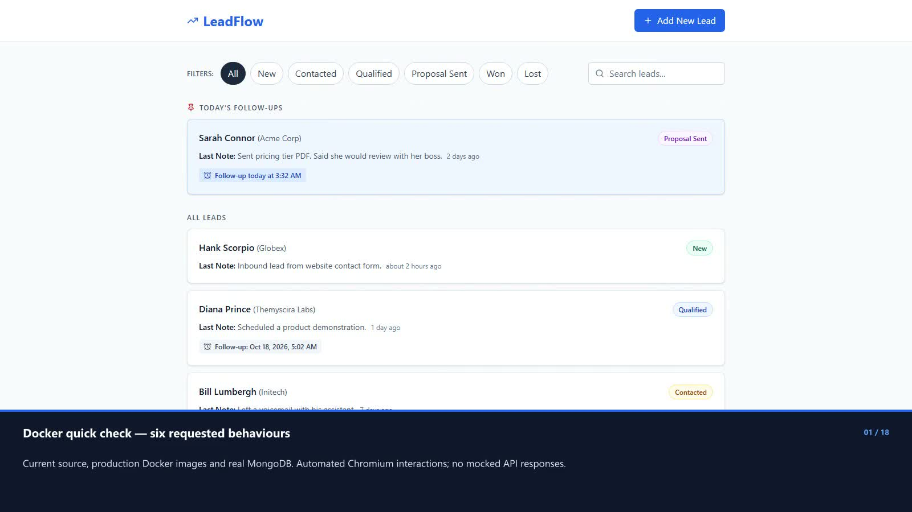
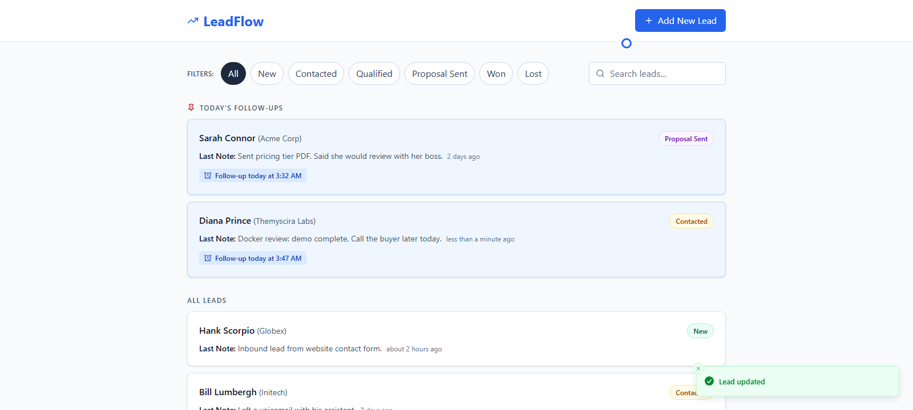
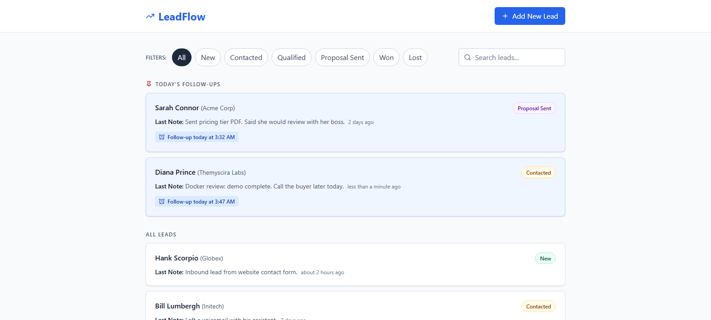
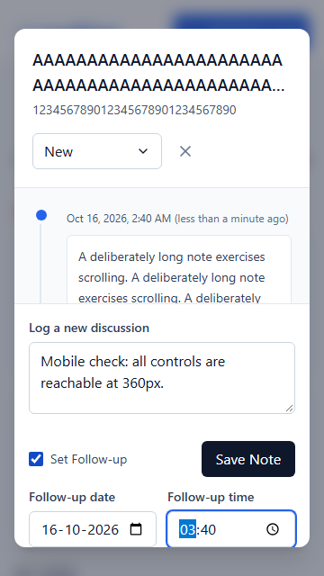

# LeadFlow Docker quick-check video

Codex regenerated this automated, annotated recording on October 16, 2026, from HEAD `91bc269`, using Playwright/Chromium; it is not a manual screen capture. I changed only the presentation and its evidence files, with no application code changes. The recording uses automated interactions against production Docker images and a real isolated MongoDB instance.

I provide the [current local MP4](demo/docker-quick-check.mp4): **72.6 seconds**, **1600×900**, **30 fps**, H.264 and silent. Codex burns annotations into the frames, retains interactions at normal speed and trims setup and unrecorded transitions. I require no subtitle file. The earlier GitHub release asset predates this regenerated local revision.

## Presentation corrections

Codex gives each of the six checks its own CHECK intro card and green-accented PASS result card over the live app. For check 3, Codex uses separate 3a and 3b cards for empty-name rejection and name-only creation. Codex shows Diana's Contacted badge before a full reload, the reload itself, and the same badge on an explicit AFTER F5 / PASS card. Codex limits the mobile sidebar to controls reachable and no horizontal overflow, then ends with the six-line summary.

## Results

- PASS — A note with a follow-up later today pins the lead without a reload.
- PASS — A status change survives a full browser reload (F5 equivalent).
- PASS — Add Lead rejects an empty name; a name-only lead appears as New.
- PASS — Bill marked Won uses a grey card and neutral follow-up chip.
- PASS — At 360×640, date, time and Save Note are reachable with no horizontal overflow.
- PASS — Esc closes the dialog and returns focus to Diana.

## Video timings

| Time | Card or action                                  |
| ---- | ----------------------------------------------- |
| 0:00 | Docker quick check — six requested behaviours   |
| 0:03 | CHECK 1 / 6 — Note + follow-up later today      |
| 0:10 | PASS 1 / 6 — Pinned immediately, no reload      |
| 0:14 | CHECK 2 / 6 — Status survives F5                |
| 0:19 | BEFORE F5 — Diana: Contacted                    |
| 0:22 | F5 — Full browser reload                        |
| 0:23 | PASS 2 / 6 — AFTER F5: Diana is still Contacted |
| 0:27 | CHECK 3a / 6 — Reject an empty name             |
| 0:29 | PASS 3a / 6 — Empty name rejected               |
| 0:33 | CHECK 3b / 6 — Create with a name only          |
| 0:36 | PASS 3b / 6 — Name-only lead appears as New     |
| 0:40 | CHECK 4 / 6 — Won must be neutral               |
| 0:45 | PASS 4 / 6 — Bill is Won, grey, never red       |
| 0:50 | CHECK 5 / 6 — Controls at 360 × 640             |
| 0:53 | PASS 5 / 6 — Controls reachable; no overflow    |
| 1:01 | CHECK 6 / 6 — Esc closes the dialog             |
| 1:03 | PASS 6 / 6 — Esc closed the dialog              |
| 1:07 | All six checks passed on the Docker build       |

## Visible F5 evidence

Codex holds Diana's actual Contacted badge on screen before the reload and again afterward. I verify that the document identifier changes and the API record remains Contacted.

## Mobile scope

I use a real 360×640 viewport with a 120-character unbroken name and company. I scroll date, time and Save Note into view, assert full viewport visibility and containment inside the dialog, check `document.documentElement.scrollWidth <= innerWidth`, and save a note successfully. I make no claim in this clip about responsive filter interactions or testing the full discussion history.

## Verification and isolation

I pass all six checks in rehearsal and in the recorded take, observing 21 successful browser API responses and no unexpected browser errors or failed HTTP responses. I verify seven CHECK/PASS pairs because the third check has two separate cases. I decode the complete video, inspect the result frames, and detect no frozen intervals of eight seconds or longer.

I use a separate `leadflow-video` Compose project, built through the unchanged repository Dockerfiles. I use frontend port 3100 and API port 4100. MongoDB uses temporary in-memory storage and publishes no host port. I seed only this isolated database, then shut down only this isolated project, without any volume-removal command.

I verify that the original `leadflow` project retains its container IDs and identical lead/discussion data. I do not run destructive commands against its volume. I keep recording helpers and raw takes under ignored `.cache/`.

I distinguish this automated browser recording from a human personal review. I do not rerun the unchanged application unit-test gates for this presentation-only change.

I retain the [check results, presentation inventory, Docker provenance and cleanup verification](demo/docker-quick-check-verification.json). Video SHA-256: `c96b64dafdc95305f7aee7ddf58cd8c46adcc67a779f855d95a75bc41ff06036`.
